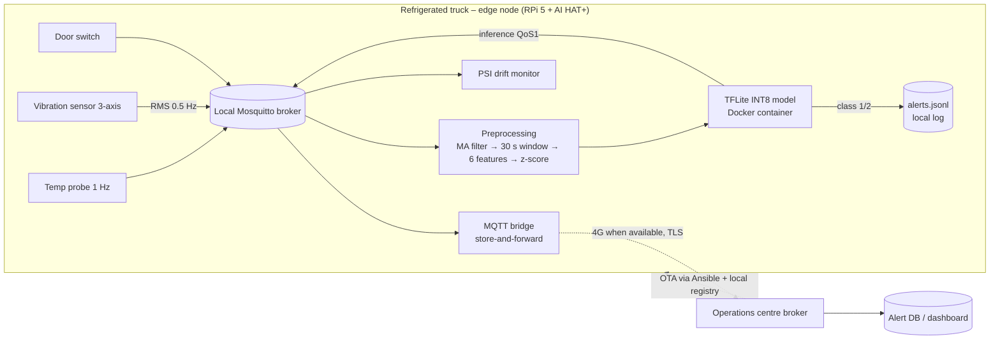

# Constraint analysis – worked numbers (Component A)

> These are the calculations and facts to build your 350–500-word A1 answer on. Write the prose yourself;
> RTT figures marked *(cite)* need a source you choose (TRAI / OpenSignal / your own ping test).

## Latency (90 s SLA)

- Fault → +1 °C/min. Breach threshold (Critical) is +3 °C → ~3 min from fault to breach; SLA = alert within 90 s.
- **Edge path (measured design):** 30 s window + ≤10 s step + moving-average lag (5 samples: 5 s temp, 10 s vibration)
  + inference ≈ 0.02 ms + local MQTT < 10 ms → **worst case ≈ 50 s**, typical ≈ 30–40 s. In the live test the first
  window after injecting `--anomaly combined` was already classified Critical.
- **Cloud path:** rural 4G RTT ~100–300 ms, 3G/EDGE fallback 0.5–2 s *(cite)* — fine when connected, but raw
  vibration needs 6 KB/s ≈ 48 kbps sustained uplink, marginal on EDGE. During a coverage gap latency = gap length
  (35–90 min) ≫ 90 s → **cloud inference is not feasible**.

## Bandwidth (per truck per day, float32 = 4 B, 1 MB = 10^6 B)

| Stream | Rate | Bytes/s | Per day |
|---|---|---|---|
| Temperature | 1 Hz × 4 B | 4 | 0.35 MB |
| Vibration | 500 Hz × 3 axes × 4 B | 6,000 | 518.40 MB |
| Door | ~50 events × 16 B | – | ~0.001 MB |
| **Raw total** | | | **≈ 518.75 MB** |

- Raw upload cost @ ₹0.10/MB: **₹51.9 / truck / day** → 85 trucks ₹4,409/day ≈ **₹16.1 lakh/yr**; 265 trucks ≈ ₹50.2 lakh/yr.
- Edge-processed: inference summaries 8,640/day × ~330 B ≈ 2.85 MB/day (₹0.29); alerts only ~50/day × 330 B ≈ 16.5 KB/day (₹0.002).
- Reduction: ~180× (summaries) to ~31,000× (alerts only).

## Connectivity

- Nashik–Aurangabad: 7 dead zones × 35–90 min = **4.1–10.5 h without signal per trip**.
- Cloud-only: no inference, no alerts during gaps; at 1 °C/min a 35-min gap allows a +35 °C excursion before anyone knows (the ₹28 lakh incident).
- Edge: local broker + on-device model keep working; alerts are written to `alerts.jsonl` and queued by the Mosquitto bridge
  (QoS 1, persistent session), then flushed when coverage returns. A local buzzer/driver display can be driven from the same `alerts` topic.

## Privacy

- Raw sensor data never leaves the truck; only alert/inference summaries go over a TLS-authenticated bridge (per-truck client certs).
- Supports contractual clauses: data minimisation, an auditable local chain-of-custody log, no third-party cloud processor holding cargo data.

## System architecture diagram (A2)

Paste into https://mermaid.live and export as `system_architecture.png`, or redraw by hand.

